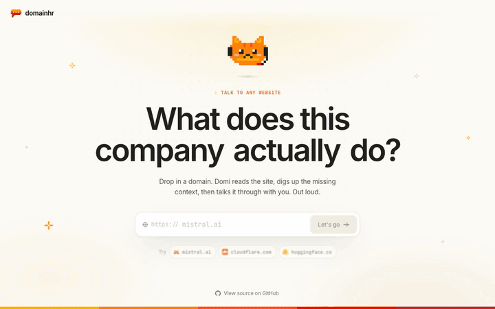
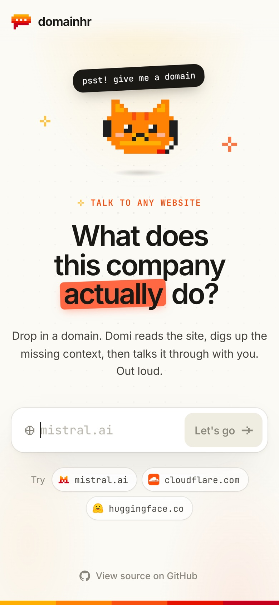
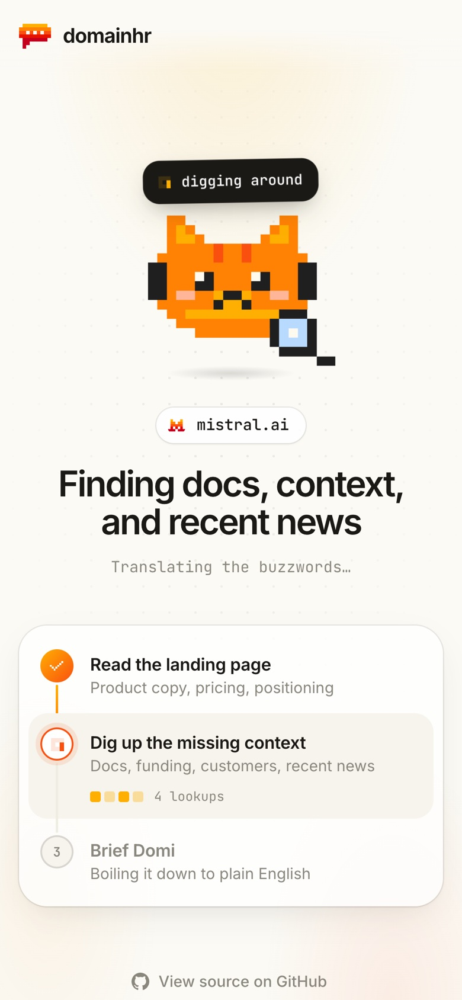
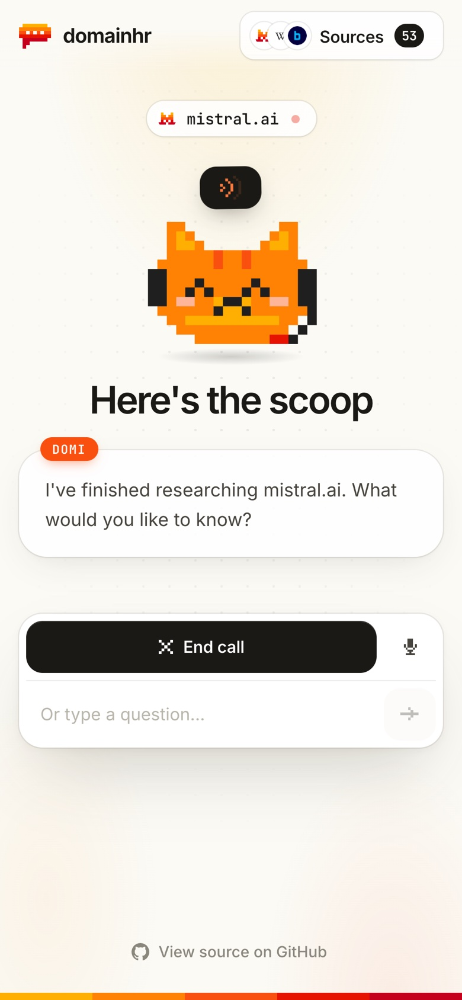
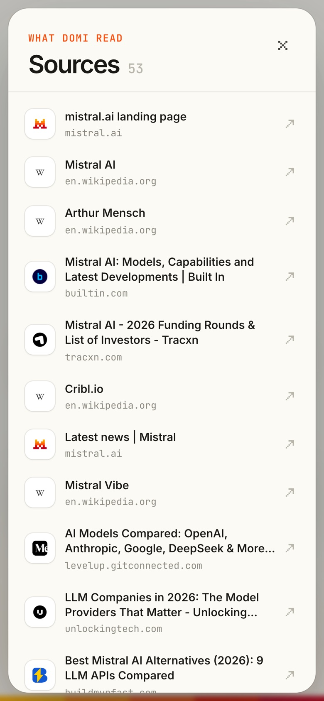
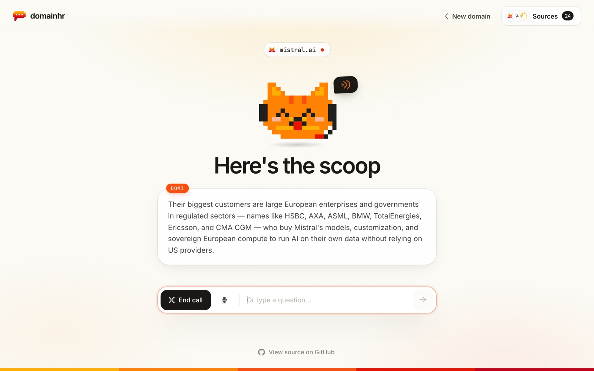
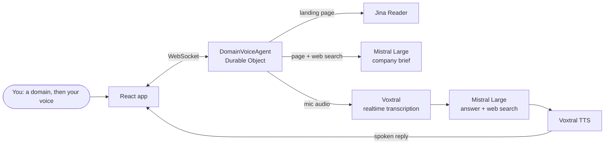
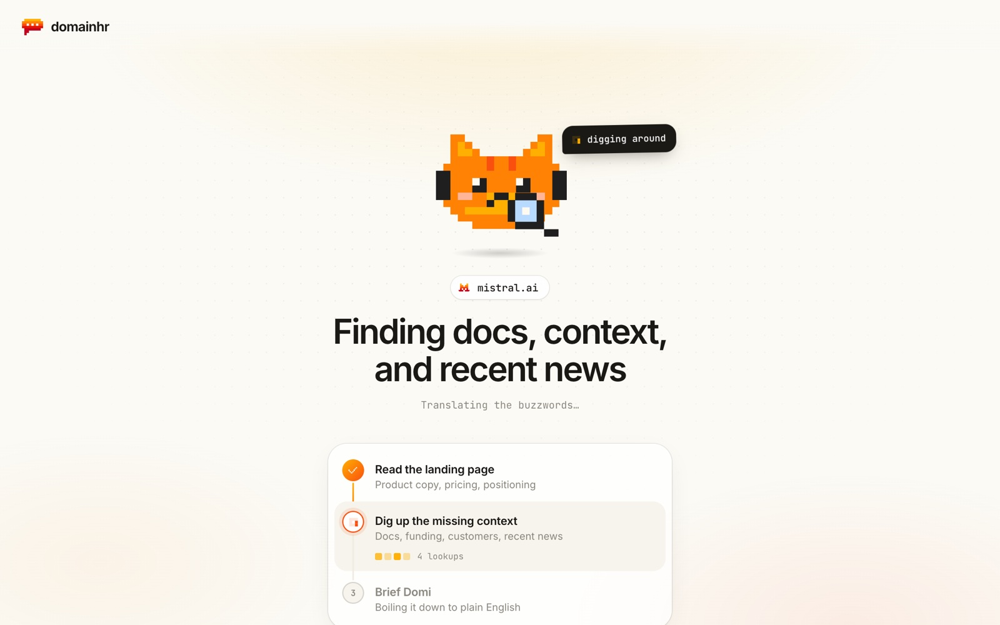
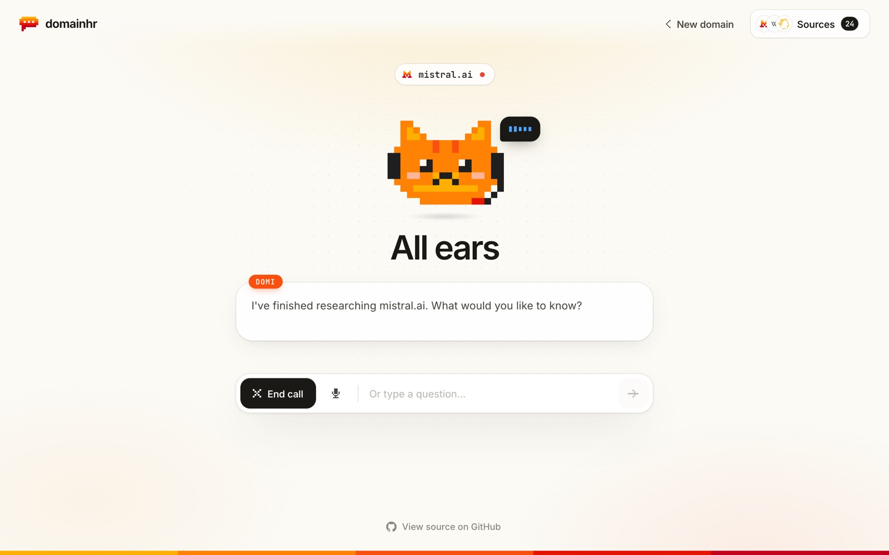

<div align="center">

# domainhr

**Drop in a company's domain. Talk to it out loud to find out what that company actually does.**

A demo of [Voxtral](https://docs.mistral.ai/capabilities/audio/) and [Mistral Large](https://docs.mistral.ai/getting-started/models/) running on [Cloudflare Workers](https://developers.cloudflare.com/workers/) with the [Agents SDK](https://developers.cloudflare.com/agents/).



</div>

## What it does

<table>
<tr>
<td align="center" width="25%"><br><sub>Type a domain</sub></td>
<td align="center" width="25%"><br><sub>Domi does the reading</sub></td>
<td align="center" width="25%"><br><sub>Ask him anything, out loud</sub></td>
<td align="center" width="25%"><br><sub>Check his sources</sub></td>
</tr>
</table>

- **Reads the site for you.** Domi pulls the landing page, then runs several rounds of web searches for docs, funding, customers and news. A step tracker counts each lookup as it happens.
- **Talks it through.** Ask questions with your voice and Domi answers out loud, in plain English. He can search the web again mid-conversation.
- **Lets you interrupt.** Start talking while Domi is speaking and he stops to listen.
- **Shows what he's doing.** A pixel bubble next to Domi shows sound bars that follow your voice while he listens, bouncing dots while he thinks, and sound waves while he speaks.
- **Keeps receipts.** Every page Domi read is one click away in the Sources panel, usually 20 to 60 of them.
- **Takes typed questions too.** Prefer not to talk? Type your question in the box instead.



You don't need any data of your own: click one of the suggested domains, such as `mistral.ai` or `huggingface.co`. Some sites block automated readers; Domi tells you when he can't read one.

## How it works



1. You type a domain. The page opens a WebSocket to a `DomainVoiceAgent`, a Durable Object built with the [Agents SDK](https://developers.cloudflare.com/agents/) and `@cloudflare/voice`. Each browser tab gets its own agent.
2. The agent fetches the landing page as markdown through [Jina Reader](https://jina.ai/reader/), then asks Mistral Large (`mistral-large-4`) to write a company brief using Mistral's built-in web search. Each search and source streams to the page as it runs. This usually takes 35 to 55 seconds.
3. When you speak, your mic audio streams to Voxtral realtime transcription (`voxtral-mini-transcribe-realtime-3`). After about 1.2 seconds of silence, the transcript goes to Mistral Large, which answers from the brief and can search again.
4. Voxtral TTS (`voxtral-mini-tts-3`) turns the answer into speech and streams it back. Domi usually starts talking a few seconds after you stop.

<table>
<tr>
<td width="50%"></td>
<td width="50%"></td>
</tr>
<tr>
<td align="center"><sub>Research: landing page, web searches, then the brief</sub></td>
<td align="center"><sub>Voice: Domi listens, thinks, then speaks</sub></td>
</tr>
</table>

TypeScript throughout: a Cloudflare Worker for the backend, React with Vite for the UI.

```
src/index.ts       Worker and DomainVoiceAgent: research, voice turns, /api/health
src/mistral-*.ts   Mistral conversations, Voxtral transcription and speech
src/client/        React UI: screens, pixel art, playback tracking
test/              Vitest unit tests
```

## Run it locally

You need [Node.js](https://nodejs.org/) 22.12 or later, a [Mistral API key](https://console.mistral.ai/api-keys) and a browser with a microphone. You don't need a Cloudflare account: everything runs locally.

```bash
git clone https://github.com/megaconfidence/domainhr.git
cd domainhr
npm install
cp .env.example .env   # then paste your key after MISTRAL_API_KEY=
npm run dev
```

Open <http://localhost:5173>, click **mistral.ai**, then **Let's go**, and allow the microphone when your browser asks. Once Domi has finished reading, ask him a question.

### Settings

| What | Where | Default |
| --- | --- | --- |
| Model for research and answers | `MISTRAL_MODEL` in `wrangler.jsonc` | `mistral-large-4` |
| Text-to-speech model | `MISTRAL_TTS_MODEL` in `wrangler.jsonc` | `voxtral-mini-tts-3` |
| Domi's voice | `MISTRAL_TTS_VOICE_ID` in `.env` | `gb_jane_neutral` |
| Jina Reader key, for higher rate limits | `JINA_API_KEY` in `.env` | none (works without) |
| Transcription model | `STT_MODEL` in `src/mistral-voice.ts` | `voxtral-mini-transcribe-realtime-3` |
| Silence before Domi answers | `silenceDurationMs` in `src/client/App.tsx` | `1200` ms |
